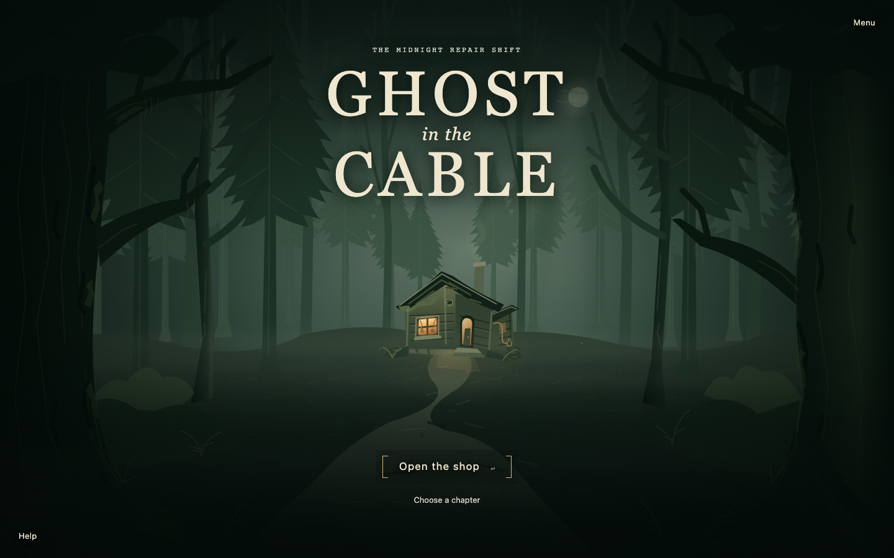
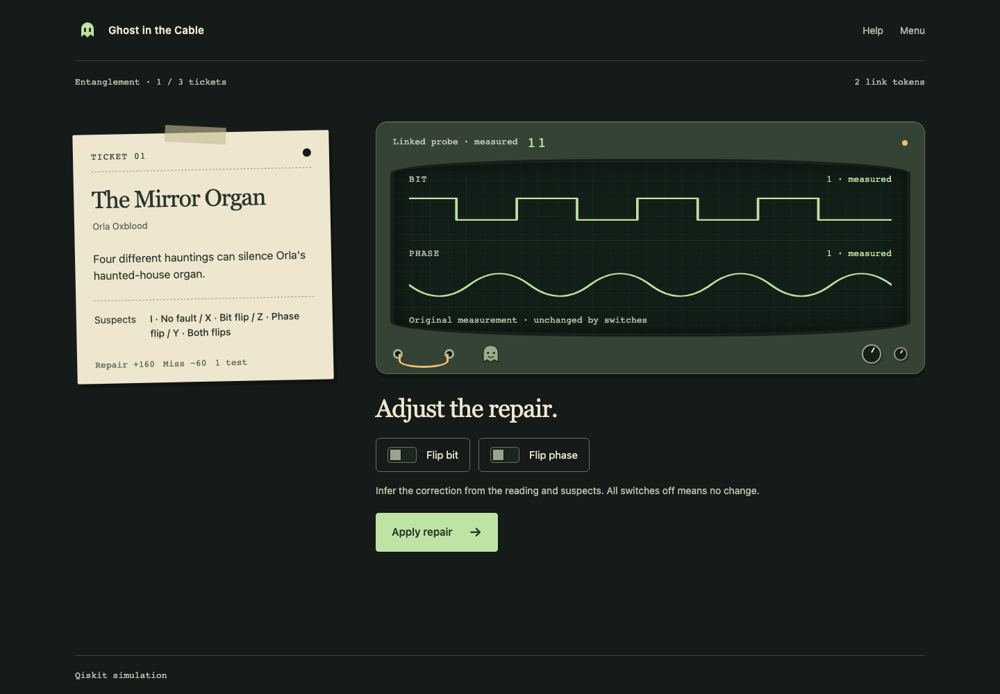

# Ghost in the Cable

### One cable. One test. Choose what you need to know.



A small Halloween puzzle game built for **Qiskit Fall Fest Warsaw 2026 · Track 3**. Run a haunted repair shop, learn your instruments on spare cables, then decide how to diagnose each customer's single-use cable.

The quantum part is real **Qiskit circuit simulation**. The story, artwork and interface are original. No IBM account, API key or physical quantum processor is needed.

## Start the night

Requires **Python 3.12**, **uv**, and **Node.js 22.13+ with npm** (tested with Node 26.0.0). Internet is needed to install dependencies; the installed game uses no external services.

```bash
git clone https://github.com/Rionlyu/ghost-in-the-cable.git
cd ghost-in-the-cable
./run.sh
```

Open **http://127.0.0.1:8000**. Stop the server with **Ctrl+C**.

The launcher installs locked dependencies, builds the browser app and starts one local Python server. If port 8000 is already occupied, stop the earlier instance first. This is a local demo, not a hosted play link or a GitHub Pages application.

<details>
<summary>Manual setup and development</summary>

```bash
uv sync --frozen
npm --prefix web ci
npm --prefix web run build
uv run --frozen uvicorn server.app:app --host 127.0.0.1 --port 8000
```

For frontend development, keep the Python server running and use a second terminal:

```bash
npm --prefix web run dev
```

Vite proxies `/api` to Python. Do not open `index.html` directly: Qiskit executes on the backend.

</details>

## How it plays

- **Arrive through the woods.** A full-screen forest approach leads to the workshop. Skip, Escape and reduced motion are supported. **Menu → Replay intro** restarts the whole game from the forest, with confirmation before replacing an active game.
- **Learn on spare cables.** Seven short, resettable experiments introduce bit flips, relative phase and an entangled reference. Training never uses a customer's query or link token.
- **Make your own diagnosis.** Read the possible faults, choose an instrument and commit to one test. Switches send a visible pulse through the CRT, but the measured evidence stays fixed: there is no live “correct answer” preview.
- **Spend references deliberately.** The eight-ticket story gives you three link tokens. Ordinary probes are free; the Linked probe spends a token to distinguish all four ideal faults in one cable use.
- **Learn from the result.** Only after you commit does the server check the repair, stamp the ticket and reveal its fault and actual circuit. Help remains available when you need a reminder.

Short chapters focus on **Bits** (3 repairs), **Phase** (2) and **Entanglement** (3). Sound is opt-in; motion can be disabled in Menu.



## The quantum idea

The hidden cable applies one of four ideal operations:

| Fault | Meaning | Bit probe | Phase probe | Linked probe |
| :--- | :--- | :---: | :---: | :---: |
| I | Leave unchanged | 0 | 0 | 00 |
| X | Bit flip | 1 | 0 | 10 |
| Z | Phase flip | 0 | 1 | 01 |
| Y | Both flips, up to global phase | 1 | 1 | 11 |

A Bit probe cannot distinguish I from Z; a Phase probe cannot distinguish I from X. Linked prepares an entangled pair, sends **only one qubit through the cable**, keeps the other as a reference, and decodes them together.

For **four equally likely faults and one cable use**, an unassisted single-qubit probe has an optimal identification ceiling of **50%**; the ideal entangled-reference strategy reaches **100%**. The simpler two-suspect tickets are a different problem and can be solved perfectly with the appropriate ordinary probe.

Linked strings use Qiskit's `c1c0` order. After the joint decoder, the **first displayed bit identifies a bit flip**, and the second identifies a phase flip. Before decoding, either qubit alone is locally random.

This demonstrates an **information advantage under a specified query constraint**, not a computational speedup, a new quantum protocol or a result from quantum hardware. The mechanism is related to established superdense coding and channel discrimination. [Science and derivation](docs/SCIENCE.md) · [Prior art and contribution](docs/PRIOR-ART.md)

## Reproducible evidence

The checked-in benchmark contains **393,216 sampled outcomes**, including a synthetic noise sweep. Its ideal-condition results are:

| Strategy | Correct / trials | Accuracy |
| :--- | ---: | ---: |
| Ordinary Bit/Z | 8,192 / 16,384 | 50% |
| Ordinary Phase/X | 8,192 / 16,384 | 50% |
| Two-qubit classically correlated reference | 8,192 / 16,384 | 50% |
| Entangled Bell reference | 16,384 / 16,384 | 100% |

The unentangled two-qubit control helps separate the role of entanglement from simply having another qubit. The benchmark builds reference circuits independently of the game engine; fault labels are not provided to its decoders.

```bash
uv run --frozen python -m benchmarks --shots 4096 --seed 20261024 --output evidence/benchmark.json
```

[Recorded JSON](evidence/benchmark.json) · [Noise chart](evidence/benchmark.svg) · [Verification record](docs/RELEASE-CHECK.md)

## Run the checks

```bash
uv sync --frozen
uv run --frozen pytest -q -W error
uv run --frozen ruff check .
uv run --frozen ruff format --check .
npm --prefix web ci
npm --prefix web test
npm --prefix web run build
```

For browser checks, start the Python server with the built frontend, then:

```bash
cd web
npx playwright install chromium
LIVE_API=1 ATMOSPHERE_LIVE=1 PLAYWRIGHT_BASE_URL=http://127.0.0.1:8000 npm run test:e2e -- --workers=1
```

Tests cover actual circuits, hidden-fault boundaries, single-query and token enforcement, stale-tab revisions, training isolation, full chapters, recovery, cinematic replay and responsive interaction. Some browser tests deliberately use transport fixtures; only the explicitly live tests exercise the real backend.

## Inside the project

| Directory | Purpose |
| :--- | :--- |
| `server/` | FastAPI, real Qiskit execution and server-owned sessions |
| `web/` | TypeScript, Vite, original SVG/CSS scenery and Playwright tests |
| `benchmarks/` | Independent circuits and reproducible sampling |
| `tests/` | Physics, API, replay and benchmark tests |
| `evidence/` | Recorded benchmark and scoped review artifacts |
| `docs/` | Scientific explanation, playtesting and release notes |

## Limits and credits

- The campaign uses ideal deterministic Pauli faults, not arbitrary hardware noise. The noise experiment is separate and synthetic.
- Shifts live in one server process. Refresh resumes an existing shift; restarting the server loses it. There is no account, durable database or leaderboard. Keep session identifiers private.
- This is a loopback hackathon demo, not a hardened public multi-user service. GitHub hosts the source, not the running Python application.
- No beginner learning gains or full accessibility certification are claimed. [Playtest protocol](docs/PLAYTEST.md) records what still needs human evaluation.
- Developed by **Beniamin Kmieć**, with AI assistance through **Hermes Agent** for implementation, research, tests and original assets. No third-party game art, music or fonts are bundled. [Credits](NOTICE.md)
- Licensed under **MIT**; dependencies retain their own licenses. This project is not an official IBM product.

**For the entrant:** [submission audit](docs/SUBMISSION-AUDIT.md). A published repository is not itself an accepted hackathon submission.
